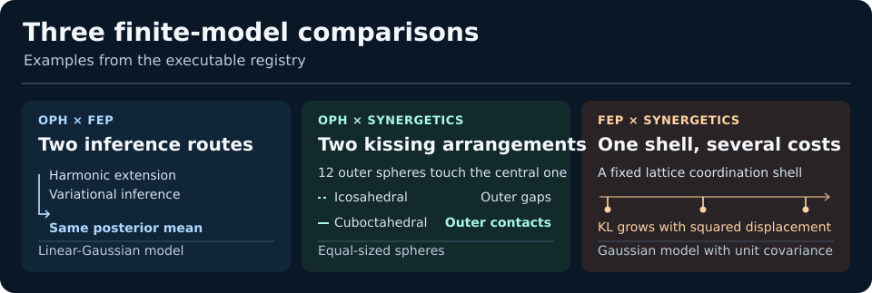

# OPH-FEP-Synergetics

This package compares OPH's finite observer, a Gaussian model for variational
inference, and Fuller's lattice geometry. Its executable registry reports
which correspondences hold, where a proposed identification fails, and which
constructions can be used together.

- **Observer Patch Holography** (OPH) — an executable observer on a twelve-port
  icosahedral carrier with a native integer repair law.
- **The Free Energy Principle** (FEP) — variational inference and the
  conditional-independence structure of a Markov blanket.
- **Fuller's Synergetics** — the isotropic vector matrix, its cuboctahedral
  coordination shell, and tetravolumes computed from quadray coordinates.



The diagram shows one example for each pair in the
[executable correspondence ledger](docs/CORRESPONDENCES.md).

[*Observers, Blankets, and Screens*](output/pdf/OPH-FEP-Synergetics_combined.pdf)
is the paper by Daniel Ari Friedman and
[Bernhard Mueller](https://orcid.org/0009-0002-5638-6240). The manuscript build
binds numerical results to computations or cited sources.

## What runs

```
oph-fep-synergetics verify                 # all 83 correspondence probes
oph-fep-synergetics verify --json          # the same, as a machine-readable report
oph-fep-synergetics verify --key pr01-obstruction
oph-fep-synergetics verify --key jitterbug-octahedral-gaussian-limit --key jitterbug-averaged-repair-limit
oph-fep-synergetics verify --pair synergetics-oph   # one pairwise ledger
oph-fep-synergetics verify --kind disagreement       # one kind of claim
oph-fep-synergetics sources                # pins, licences and reuse policy
oph-fep-synergetics sources --vault-root /path/to/vault   # check live checkouts
oph-fep-synergetics values                 # every number the manuscript may quote
oph-fep-synergetics carrier                # carrier counts, gap, shell sizes
oph-fep-synergetics geometry               # IVM moves, shell counts, volumes
```

`verify` exits `1` when a probe fails and `2` when a filter is unknown or
the combination of filters selects no probes.

## Install

```
uv sync --locked --extra dev --extra figures
uv run --locked --extra dev --extra figures oph-fep-synergetics verify
```

The package requires Python 3.14 or newer and NumPy. The `dev` extra adds
pytest and pytest-cov. The `figures` extra adds Matplotlib for the figure suite
and manuscript build. Add `--no-editable` to `uv sync` for a regular install.
The installed `sources` command reads the bundled source register from any
working directory.

For a resolver-based installation using pip, run the following with a supported
Python interpreter. Pip resolves the dependency bounds in `pyproject.toml`.

```sh
python3 -m venv .venv
.venv/bin/python -m pip install -e ".[dev,figures]"
```

## Layers

| layer | module | what it holds |
| --- | --- | --- |
| `core` | `core/carrier.py` | OPH's twelve-port carrier, its port chart, Laplacian, spectrum and load shell |
| | `core/repair.py` | the native seam-repair law, its conservation law and its exact energy decrease |
| | `core/native_dynamics.py` | ungated and gated rewrite relations, the binary attempt kernel, ensemble relaxation and the conditional-variance identity |
| | `core/sheaf.py` | cellular sheaves, agreement energy, harmonic extension, record injectivity, cohomology dimensions |
| | `core/free_energy.py` | the linear-Gaussian free-energy dictionary and the three named surprises |
| | `core/controls.py` | the obstruction and dynamics controls: descent census, D-stability, mediators, orbits, free-energy forms |
| | `core/invariants.py` | the Laplacian's counting identities: spanning trees, reciprocal spectrum, GMRF precision, Markov blankets |
| | `core/symmetry.py` | the carrier's automorphism group, orientation classes, orbit counts and equivariance |
| | `core/network.py` | exact resistances, Kirchhoff index, distance shells, the subgraph census, and the first-eigenspace comparison with icosahedral chords |
| | `core/centroid_dynamics.py` | exact covariance and memory of the observed repair centroid |
| | `core/weighted_duality.py` | weighted planar dual covariance and the copied-conductance counterexample |
| | `core/quadratic_modes.py` | trace-free quadratic frames and Gaussian coefficient precision |
| | `core/geometric_screening.py` | central-plane separators and Gaussian information between strict halves |
| | `core/contrast_quotients.py` | distance-regular repair and resistance collisions on bipartite and periodic FCC graphs |
| | `core/root_shells.py` | quadratic precision across root shells and the one-seam covariance defect |
| | `core/surface_duality.py` | harmonic covariance and nonreciprocal weights on a square torus |
| | `core/constraint_screening.py` | constrained Gaussian half-fields on larger FCC boundaries |
| | `core/jitterbug_inference.py` | exact weighted matching contrasts and coordinate lag closure |
| | `core/jitterbug_motion.py` | moving-coordinate covariance and the invariant six-slot readout |
| | `core/jitterbug_projection.py` | finite pair-mean precision and pair-total lag defects |
| | `core/jitterbug_repair.py` | stationary pair-load memory and the accelerated octahedral repair limit |
| `geometry` | `geometry/quadray.py` | quadray coordinates, the A3/IVM embedding and exact tetravolumes |
| | `geometry/lattice.py` | IVM shells, quadray classes of FCC sites and interstices, the cuboctahedral shell, Voronoi cell and packing density |
| | `geometry/subdivision.py` | icosahedral subdivision and the dual count identities |
| | `geometry/solids.py` | oriented faces, polyhedron volume, and the icosahedron's tetravolume against its closed form |
| | `geometry/jitterbug.py` | fixed-bar Jitterbug coordinates and exact hull, bar and nearest-pair comparisons |
| `analysis` | `analysis/registry.py` | the 83 registered correspondences, each with a pairwise or three-way scope and an executable probe |
| | `analysis/provenance.py` | source pins, licence terms and reuse policy |
| `manuscript_variables` | `manuscript_variables/values.py` | every number the prose may quote, derived from the package where a derivation exists |

## The registry

83 entries: **40 isomorphisms**, **33 disagreements**, **10 complementarities**,
scoped to the pairs `oph-fep` (31), `synergetics-oph` (16), `fep-synergetics` (5)
and `three-way` (31). All 83 probes pass. `verify --kind` narrows a run to one of
the three kinds and `--pair` to one of the four scopes. The full table, with the OPH / FEP /
Synergetics reading of each entry and the values its probe asserts, is generated
into [docs/CORRESPONDENCES.md](docs/CORRESPONDENCES.md).

The [three-way chapter](manuscript/07_three_way_limits.md) compares the OPH
carrier and the FCC first shell under the same finite models. It gives exact
contrast-variance quotients and tests where geometry fails to transfer between
the shells. A Gaussian process reproduces all lag covariances of the stationary
centroid on either shell, yet three-time events detect memory.

The [transfer chapter](manuscript/07_transfer_criteria.md) proves when these
claims generalise. It checks a cube quotient, resistance collisions on
periodic FCC, a weighted twenty-four-cell, harmonic covariance on a torus
and plane screening under global constraints.

The [Jitterbug chapter](manuscript/07_jitterbug.md) reconstructs Fuller's
fixed-bar path from the cuboctahedron through the regular icosahedron to
octahedral joint coalescence. The nearest-only graph separates into dimers
after regularity. Tuning gives Gaussian covariance closure at each fixed
pose. Moving the coordinate readout introduces a signed residual. Retaining
six fixed components restores the covariance match. At finite weights,
hidden pair differences affect both the marginal Gaussian precision and
the two-step repair covariance. The hard Gaussian constraint gives a
doubled octahedral precision. Fast within-pair mixing gives an octahedral
occupancy process on the accelerated clock.

Selected results follow.

| claim | status | evidence | source or derivation |
| --- | --- | --- | --- |
| OPH's carrier port chart is derived from its oriented faces | exact | 12 ports, 30 seams and 20 faces. Each port has five neighbours, and the graph triangles recover the face vertex sets. | OPH’s oriented faces, with the adjacency derived here |
| The icosahedral Laplacian determines the mean port relaxation gap | exact | `lambda_1 = 5 - sqrt(5)`. With uniform seam selection and a fair coin, the mean repair operator is `I - L / (2\|E\|)`, with gap `(5 - sqrt(5)) / 60`. The same `L` supplies the blocks of the Gaussian model. | [Agreement and Surprise][agreement-and-surprise], §6.2, for the mean gap |
| The native repair law conserves load and changes `sum(x^2)/2` by `-(d^2 - (\|d\| mod 2)) / 4` | exact | checked on all 4680 transitions on the shell of total load two | [OPH][oph-source], native repair law |
| On the binary shell each native repair is exact Bayesian conditioning and a variational step | exact on that domain | all 3,960 cases agree with the uniform binary reference conditioned on the preserved seam record. The minimum variational free energy on the fibre is the datum's surprisal, `log 33` or `log 66`. The uniform full-shell reference gives 60 failures across doubled-state and incident-seam pairs. | [Agreement and Surprise][agreement-and-surprise], §§6.2 and 7.3, and the [OPH synthesis][oph-synthesis] |
| The binary repair Dirichlet form equals the mean conditional variance | exact on that domain | the two forms have identical coefficients on all 66 states. The probe checks all 30 seams and 300 two-state fibres under uniform seam choice and fair repair. | Exact finite-shell comparison using conditional-expectation operators |
| The mean of the native law is one step of the carrier Laplacian | exact | averaging the integer rule over the 60 seam-and-coin draws gives `x - L x / 60` in exact rationals on all 78 configurations | [OPH][oph-source], native fields; exact enumeration here |
| Patch agreement is the global-section condition of a cellular sheaf, and the sheaf Laplacian is the carrier Laplacian | exact | `carrier_sheaf(carrier).laplacian() == carrier.laplacian()` | [Agreement and Surprise][agreement-and-surprise], §7.2 |
| On the linear-Gaussian carrier, constrained relative-entropy minimisation and predictive-coding perception give the posterior mean | exact on that domain | harmonic extension, a separate KKT solve and perception flow agree. With a proper record prior, variational free energy equals normalised surprisal at the posterior. An asymmetric seam separates its energy minimum from its posterior mean. | [Agreement and Surprise][agreement-and-surprise], Theorem 7, items 2–3; carrier, chain and asymmetric spring checks here |
| **PR-01**. Ungated repair is confluent and can cycle. The broken-seam gate terminates and admits multiple reachable normal forms. | **obstructed** | 78 states, no ungated normal forms, 66 gated normal forms and 5 reachable from each doubled state. The binary attempt kernel separately has the same computed gap as the mean port operator. Individual binary paths preserve load energy and ensemble relative entropy is nonincreasing. | [OPH][oph-source], PR-01; exhaustive reachability and kernel checks here |
| **Three distinct values at fixed records** | **obstructed** | minimum interface energy, the unnormalised record potential and normalised surprisal differ. Two chains with equal normalised record densities give interior posterior divergences of 1/3 and 0 under the same record change. | [Agreement and Surprise][agreement-and-surprise], Theorem 7, item 3, and the equal-Schur chain control here |
| Two-record Gaussian marginals are determined by effective resistance and the record prior | exact | all 66 carrier pairs satisfy the Schur identity; seam, distance-two and antipodal resistance are 11/30, 7/15 and 1/2 | Schur elimination and an independent rational network solve |
| Icosahedral chords recover the lowest-mode contribution to Gaussian contrast variance | exact | at edge length two and unit intrinsic precision, squared chords equal 40 times the contribution from the first positive Laplacian eigenspace. The full variance and the chords have embedding ranks 11 and 3, respectively. | Exact spectral comparison of the carrier and its regular-icosahedral embedding |
| **Eliminating an interior mediator is not free** | **obstructed** | the reduced precision is `(1/3) v v^T + epsilon I`; a sum of pairwise semidefinite terms reproduces it iff `epsilon >= 1/3` | [Agreement and Surprise][agreement-and-surprise], Proposition 8; rank-one construction here |
| **Distinct drifts preserve the same stationary blanket** | **obstructed** | with a zero precision entry the internal drift is `2q eta + (q - 1) b - 2 mu`, which varies with `q` at fixed stationary covariance | [Agreement and Surprise][agreement-and-surprise], Proposition 11; Da Costa et al.’s stationary blanket example |
| **Agreement can exist and be unreachable** | **obstructed** | The clipped map has a unique fixed point at the origin and an exact synchronous cycle on the clipping boundary. The continuous relaxation has an unstable origin, a measured post-transient minimum radius of about `0.8401`, and an estimated period of `7.575`. The source reports a lower bound of `0.84` and a period of `7.58`. | [Agreement and Surprise][agreement-and-surprise], Proposition 15 |
| **D-stability is not free** | **obstructed** | Lyapunov form `P = (1/3)[[11,4,-8],[4,5,-2],[-8,-2,9]]`, `det P = 115/27`; at `k = 4` the Routh first column is `(1, 6, -2, 24)` and the scaled matrix has two right-half-plane roots | [Agreement and Surprise][agreement-and-surprise], §4.1 and Proposition 10; general Routh column here |
| **Finite phases are path functions** | **obstructed** | full and half-damped iteration share every answer, yet their centered contrasts after twelve steps differ by exactly `921633999 / 40000000000` | [Agreement and Surprise][agreement-and-surprise], Proposition 6 and §4.4; exact contrast here |
| Quadray coordinates give exact IVM geometry | exact | 12 neighbour moves at squared distance 8, shells `10k^2 + 2`, and rational volumes `1, 3, 4, 6, 20, 96`. The coordinate sum modulo four classifies FCC sites and tetrahedral and octahedral interstices. | QuadMath conventions and the lattice and volume derivations here |
| Equilibrium propagation supplies the parameter gradient the repair law does not define | exact | the two-settle contrast is `(theta - target) / (1 + beta)` exactly and tends to the exact gradient | [Agreement and Surprise][agreement-and-surprise], Theorem 21; Scellier and Bengio |
| The carrier's reduced Laplacian counts its spanning trees | exact | The grounded determinant equals `5184000`, also the product of the nonzero eigenvalues divided by `12`. In the Gaussian model with one pinned port, the integral is proportional to `5184000^(-1/2)`. | Kirchhoff’s matrix-tree theorem and the grounded Gaussian integral |
| A proper Gaussian with precision `L + I/n` has the seam graph's conditional dependencies | exact | seam precision is `-1` and each port's blanket is its five neighbours. The centered intrinsic field separately gives port variance `7/36` | Carrier Gaussian precisions and intrinsic variance calculated here |
| The faces fill the cycle space of the carrier graph | exact | For the scalar sheaf, the graph has a one-dimensional space of global sections and `dim H^1 = 19`. Adding the faces gives Betti numbers `(1, 0, 1)`. The oriented faces sum to a fundamental cycle. | Cellular sheaf construction from [Agreement and Surprise][agreement-and-surprise], §7.2; carrier cohomology calculated here |
| The symmetry group preserves the native repair law | exact | The group has 120 elements, with 60 rotations and 60 orientation-reversing symmetries. Equivariance is checked over 1123200 combinations of group element, configuration, oriented seam and coin. The shell has 4 configuration orbits and 3 outcome multisets. | Carrier automorphisms and native transitions enumerated here |
| Gaussian divergence measures half the squared Euclidean displacement | exact | At unit covariance, one IVM neighbour displacement gives 4 nats. Displacement `k m` along a neighbour direction `m` gives `4k^2` nats from the origin. | Equal-covariance Gaussian divergence applied to QuadMath’s embedding |
| **Twelve vertices is not one solid** | **obstructed** | the neighbour graph is four-regular with tetravolume 20; the carrier is five-regular with tetravolume `18.512295868219...` | [OPH][oph-source] and QuadMath geometry compared here |
| **The shell index and the free energy determine neither each other** | **obstructed** | the coordination shell is the cuboctahedral gauge `max(\|u\|_inf, \|u\|_1 / 2)`, a polyhedral norm, checked against every breadth-first shell through 12; the free energy on shell `k` ranges from `2k^2` (`2k^2 + 2` for odd `k`) to `4k^2`, attained only at the twelve vertices, and the levels 36 and 52 are each shared by two shells | The Gaussian cost and cuboctahedral gauge compared here |
| Synergetics' tetravolume table is derived, not transcribed | exact | `1, 3, 4, 6, 20, 96` come out of explicit integer vertex sets by exact convex-hull volumes in the rationals | QuadMath conventions; exact convex-hull volumes derived here |
| The carrier's own solid has an exact algebraic volume | exact | computed in exact field arithmetic as `sqrt 2 (15/2 + (5/2) sqrt 5) = 18.512295868219...`, squared exactly `175 + 75 sqrt 5`; its conjugate is `2.7009...` and the product is exactly `50` | Carrier geometry; exact field computation here |
| Both twelve-around-one arrangements attain the kissing number, differently | exact | squared edge over squared circumradius is exactly `1` for the cuboctahedron, where each outer sphere touches four others, and `2 - 2 sqrt 5 / 5` for the icosahedron, where each outer sphere touches only the centre | Carrier and vector equilibrium compared here |
| The FCC Voronoi cell gives a packing density of `pi / (3 sqrt 2)` | exact | The cell has 14 vertices, 12 rhombic faces, and 24 edges. Its tetravolume is 6 and its inscribed ball has tetravolume `pi sqrt 2`. The density attains the Kepler bound. | Exact Voronoi cell calculated here. [Formal proof of the Kepler conjecture](https://doi.org/10.1017/fmp.2017.1) |

[agreement-and-surprise]: https://philpapers.org/versions/MUEAAS-2
[oph-source]: https://github.com/FloatingPragma/observer-patch-holography
[oph-synthesis]: https://philpapers.org/rec/MUEFOC

## Scope

The executable scope is the finite OPH carrier, specified Gaussian models and
controls, and selected lattice and volume constructions. The domain of a
claim includes its reference distribution, coordinate scale, and repair
schedule where those assumptions enter the proof. Extensions to nonlinear
inference, continuum OPH, and empirical comparisons remain open. See the
[scope and limits](docs/SCOPE.md).

Three quantities that *Agreement and Surprise* states for the native law are
reproduced exactly from the protocols in OPH's public model. One attempt is a
uniform seam and a fair coin: from `(1, 1, 0, ..., 0)` the configuration stays
with probability `13/15` and reaches each of eight neighbouring configurations with probability
`1/60` (`pr01-obstruction`). The two-event observer that chooses its second
seam from its first record ends with a port-zero occupation of `35/264`,
against `1/6` with the selector disconnected (`reduction-criterion`).

## Provenance and licences

Three source programs are pinned by commit in [data/sources.json](data/sources.json)
and reported by `oph-fep-synergetics sources`. Nothing here is relicensed.

| source | licence | reuse |
| --- | --- | --- |
| [Observer Patch Holography](https://github.com/FloatingPragma/observer-patch-holography) | Apache-2.0 for software, CC BY-NC-SA 4.0 for papers, docs, figures, data and ledgers | reimplement the software with attribution; do not copy prose, and do not reuse the data or ledgers |
| [FEP_Formal](https://github.com/ActiveInferenceInstitute/fep_formal) | CC BY 4.0 | cite the DOI and the exact topic identifiers used |
| [QuadMath](https://github.com/docxology/QuadMath) | Apache-2.0 | reuse with notice and attribution |

The conventions, the embedding, the neighbour moves and the tetra-volume rule
follow QuadMath. The port chart follows OPH's `ORIENTED_BASE_FACES` and is
*derived* from it rather than transcribed, so the derivation is checkable. The
comments in this repository record the commit actually read only in
`data/sources.json`; the package's own `sources` command is the single place a
commit is reported, and a test fails if any prefix of seven or more hex digits
of a pinned commit appears in the package.

### Third-party notice

The carrier and native seam-repair law reimplement OPH's Apache-2.0 software.
The linear-Gaussian dictionary follows [Agreement and Surprise][agreement-and-surprise].
The FEP_Formal catalogue provides topic references under CC BY 4.0 (DOI
`10.5281/zenodo.19699233`). The quadray conventions and lattice arithmetic
follow Apache-2.0 QuadMath (DOI `10.5281/zenodo.16887791`). Each source keeps
its own terms, recorded with commit pins in
[data/sources.json](data/sources.json) and restated in
[docs/PROVENANCE.md](docs/PROVENANCE.md).

This project is released under the MIT licence; see [LICENSE](LICENSE).

## The manuscript

The Pandoc and LaTeX pipeline from `docxology/template` builds the paper
from `manuscript/`. Install the figure and test extras and put Poppler's
`pdftotext` on your path for the PDF checks.

The [ontology concordance](manuscript/90_ontology_concordance.md) compares
the meanings of shared terms across the three programmes and links each
comparison to its domain and executable evidence. The [structured source](data/ontology_concordance.json)
contains the stable identifiers and source references used to generate it.

```sh
.venv/bin/python scripts/build.py --template-root /path/to/template
```

The script generates figures and numerical bindings, renders the manuscript,
and checks the PDF and its log. It selects the template checkout from
`--template-root`, `$TEMPLATE_ROOT`, or the sibling `template/` directory.
An optional `--deliver` also copies the checked combined manuscript PDF
to `~/Downloads/` and prints both SHA-256 digests. The standalone poster
is written alongside the figure images.

`projects/working/OPH-FEP-Synergetics` in the template checkout must point to
the checkout you want to build. The script checks that link, uses the
template interpreter to resolve the manuscript bindings, and writes the PDF
in this project's `output/pdf/`.

The cover compares carrier port contrasts and highlights graph-distance
repair and grounded FCC screening. Pages 2 to 5 cover claim scope, the OPH
carrier, repair and lattice costs, and tetravolumes. The Jitterbug poster
on page 6 follows the linkage past the regular icosahedron to the paired
octahedral sites. It shows nearest-pair disconnection, the tuned conductance
rule, the moving-pose obstruction and the effects of hidden pair differences.
It also compares the Gaussian and repair limits at the paired endpoint.

To regenerate the figures without invoking LaTeX, run
`.venv/bin/python scripts/make_figures.py`. It writes the poster as
`output/figures/fig_ga_jitterbug.png` for the manuscript and as a standalone
vector PDF at `output/figures/OPH-FEP-Synergetics_Jitterbug_Poster.pdf`.

The contents starts on page 7 because `preamble.md` defers the automatic
`\tableofcontents` to the end of `00_00_graphical_abstract.md`. The 0.5 in
margins accommodate the reference tables.

The manuscript checks cover four contracts.

- **Numerical results have bindings.** The prose quotes computed or sourced
  results as `{{TOKEN}}`. The build checks that every token resolves and the
  tests compare the manuscript's tokens with the package's bindings.
- **Every formalism is numbered by the renderer.** Definitions and propositions
  are fenced `::: {.proposition #prop:key}` blocks referenced as `[@prop:key]`,
  and the template's `formalism.lua` owns the counters. Cross-references
  follow each statement's label when its number changes.
- **Every citation resolves.** Pandoc's `--natbib` resolves `[@key]` against
  `manuscript/references.bib`. A test asserts that the cited keys and the
  bibliography are the same set: no undefined citation, and no uncited entry.
- **Numbered material is used in the manuscript.** Authored sections refer
  to every numbered figure, table, equation and formal statement. The
  [generated concordance](docs/CONCORDANCE.md) lists that coverage. The
  render check also reads the printed figure captions back from the PDF.

## Layout

```
data/sources.json                    pinned sources, licences, cited identifiers
docs/CORRESPONDENCES.md              generated: the 83 entries and their probe values
docs/MANUSCRIPT_VALUES.md            generated: every bound value
docs/CONCORDANCE.md                  generated: claims, references and bound values quoted in figure captions
docs/PROVENANCE.md                   the pins and the reuse rules
docs/SCOPE.md                        what is reimplemented, what is cited, what is out
docs/VERIFICATION.md                 the gates and how to run them
data/ontology_concordance.json       structured terms, comparisons, evidence and limits
manuscript/                          paper, bibliography and generated ontology supplement
scripts/check_local_ci.py           checks the committed tree locally on Python 3.14
scripts/render_docs.py               regenerates the reference documents and ontology supplement
scripts/make_figures.py              renders the 31 figures, standalone vector poster and accessibility registry
scripts/build.py                     runs the four manuscript steps, ending in the render contract
scripts/z_generate_manuscript_variables.py   resolves every token into output/manuscript/
src/oph_fep_synergetics/             the package
tests/                               the suite (480 tests)
```

## Tests and local CI

Before publishing, run the local gate on the committed candidate with Git, uv,
and Poppler's `pdftotext` available.

```sh
uv run --no-project --python 3.14 python scripts/check_local_ci.py
```

The gate tests the committed tree in a fresh Python 3.14 installation. Install
the [pre-push hook](docs/VERIFICATION.md#pre-push-hook) in each checkout used to
publish `main`. The [local CI guide](docs/VERIFICATION.md#local-ci) describes the
checks. During development you can run the suite directly.

```
.venv/bin/python -m pytest tests/ -q --cov --cov-report=term-missing
```

480 tests. The suite checks exact values rather than
smoke behaviour: the 78-state shell and all 4680 transitions, the exact
rational contrast, the closed-form Routh column, the Lyapunov determinant
`115/27`, the mediator threshold at `epsilon = 1/3`, the IVM round-trip over
shell sites, the resistance ladder's exact fractions against a from-scratch solve,
and the exact volume ratios. The coverage gate is 90%, set in `pyproject.toml`.

## Regenerating the documents

```
.venv/bin/python scripts/render_docs.py           # write
.venv/bin/python scripts/render_docs.py --check   # fail when stale
```

A test runs the `--check` path, so the committed documents cannot drift from the
registry they describe.

## Contributing and citation

Issues and pull requests are welcome on the public remote,
[docxology/OPH-FEP-Synergetics](https://github.com/docxology/OPH-FEP-Synergetics).
Every candidate for `main` must pass the [local CI gate](docs/VERIFICATION.md#local-ci)
on Python 3.14. Manuscript numbers use bound tokens. Regenerate the
reference documents from their sources. [Repository instructions](AGENTS.md)

To cite this repository use the machine-readable
[CITATION.cff](CITATION.cff), which GitHub renders under "Cite this
repository". See [CHANGELOG.md](CHANGELOG.md) for changes by edition.
